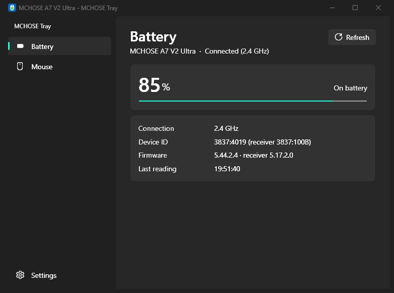
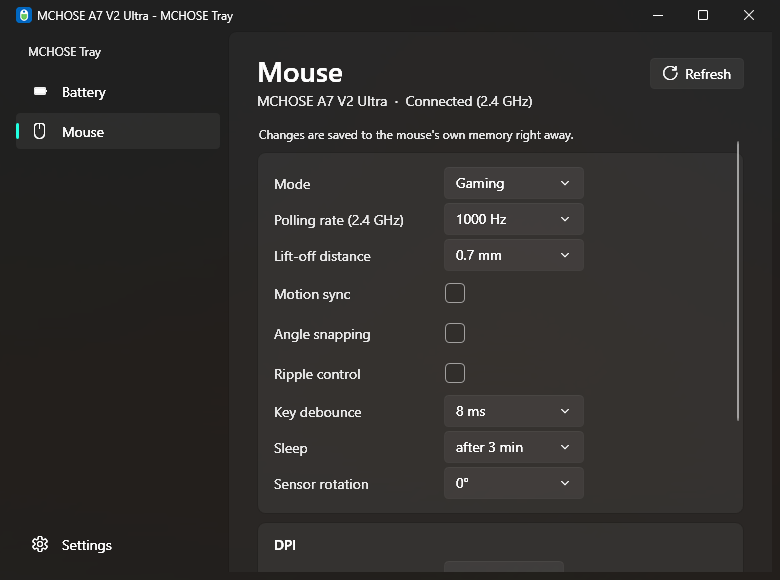
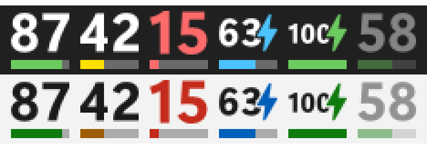
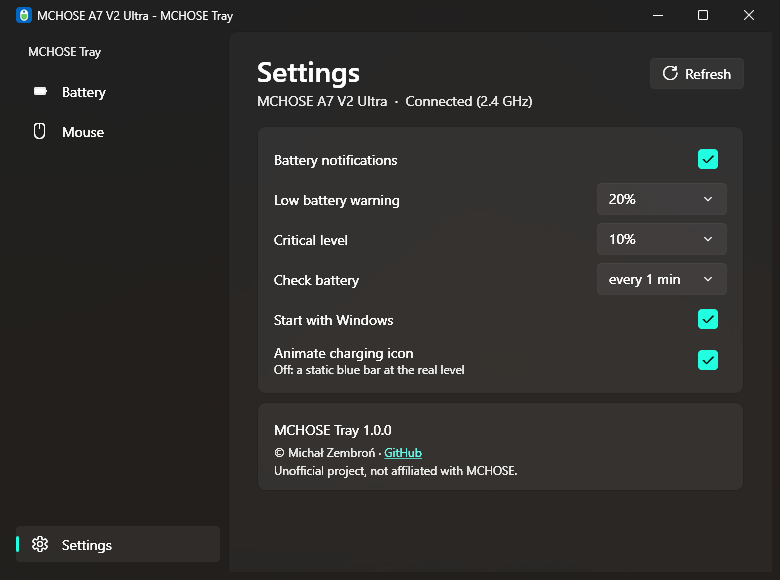

<p align="center">
  
</p>

<h1 align="center">MCHOSE Tray</h1>

<p align="center">
  A tiny, unofficial Windows tray app for MCHOSE mice — battery level and mouse settings<br>
  without the vendor software, a web driver, an account or telemetry.
</p>

<p align="center">
  
  
</p>

## Why

MCHOSE mice are configured through the vendor's M HUB — a web app (or a desktop client) that
reports usage analytics on every settings change. If it ever disappears, so does the only way to
see the battery level or change your DPI. MCHOSE Tray talks to the mouse directly over USB HID,
works fully offline and keeps working no matter what happens to the vendor's servers.

## Features

**Battery in the tray**




- Battery percentage right in the system tray, readable even at 16 px
- Colour-coded level bar: green, yellow, red when low
- While charging: a lightning bolt and an animated bar (can be turned off)
- Fully charged: green bar and bolt — time to unplug
- Dimmed when the mouse is asleep or out of range (shows the last known level)
- Notifications at a low and a critical level, and when charging is complete
- Matches a light or dark taskbar and any display scaling

**Mouse settings** — saved straight to the mouse's own memory

- Mode: Performance / Gaming / Extreme
- DPI: up to 6 stages, 200 – 42000 in steps of 1, active stage
- Polling rate: 125 – 8000 Hz (separately for the receiver and the cable)
- Lift-off distance: 0.7 / 1 / 2 mm
- Motion sync, angle snapping, ripple control
- Key debounce: 0 – 20 ms
- Sleep timer: 1 – 100 min or never
- Sensor rotation: −30° … +30°

**Everything else**



- Works over the 2.4 GHz receiver and over the USB cable, switches automatically
- Shows mouse and receiver firmware versions
- Windows 11 look: Fluent theme, Mica, navigation pane, light/dark following the system
- Optional start with Windows (per user, no admin rights)
- Light: ~1 MB executable, ~25–30 MB RAM, practically zero CPU — even with the charging animation

## Download

Grab the latest build from [Releases](https://github.com/michalzembron/MCHOSE-Tray/releases):

| File | Size | Needs |
|---|---|---|
| `MchoseTray.exe` | ~1 MB | [.NET 10 Desktop Runtime](https://dotnet.microsoft.com/download/dotnet/10.0) (x64) |
| `MchoseTray-standalone.exe` | ~65 MB | nothing |

No installer — put the file anywhere and run it. The icon appears in the tray (on Windows 11 it
may be hidden under the `^` arrow; drag it onto the taskbar to keep it visible). Click it for
details and settings, right-click for the menu.

> If you enable *Start with Windows* and later move the `.exe`, toggle the option off and on again
> so it points to the new location.

Close the official M HUB (web or desktop) while using this app — both talking to the mouse at the
same time can confuse it.

## Supported devices

| Mouse | Status |
|---|---|
| MCHOSE A7 V2 Ultra (receiver `3837:100B`, mouse `3837:4019`) | Tested — every read and write verified on hardware |
| Other MCHOSE mice using the same protocol (VID `0x3837`, vendor HID page `0xFF01`) | Should work, untested |

The device name is read from the mouse itself. If you own another model, please open an issue
with the output of `tools/MchoseCli` (read-only by default) — it tells quickly whether the model
speaks the same protocol.

## Privacy and safety

- **No network access at all.** The app only talks to the mouse over local USB HID.
- Settings live in `%LOCALAPPDATA%\MchoseTray\settings.json`; autostart is a value named
  `MchoseTray` in `HKCU\Software\Microsoft\Windows\CurrentVersion\Run`. Nothing else is written.
- The protocol library only sends an explicit whitelist of commands: status and config reads, plus
  single-setting writes that were each verified on hardware by diffing the full config block.
  Commands that reset the mouse, overwrite the whole configuration or update firmware are not
  implemented and cannot be sent.

## Building

Requires the [.NET 10 SDK](https://dotnet.microsoft.com/download/dotnet/10.0) on Windows.

```powershell
dotnet build MCHOSE.sln

# small single-file exe (needs the .NET 10 Desktop Runtime)
dotnet publish MCHOSE.csproj -c Release -r win-x64 --self-contained false `
  -p:PublishSingleFile=true -p:DebugType=none -o publish/fd

# standalone exe (no runtime needed)
dotnet publish MCHOSE.csproj -c Release -r win-x64 --self-contained true `
  -p:PublishSingleFile=true -p:IncludeNativeLibrariesForSelfExtract=true `
  -p:EnableCompressionInSingleFile=true -p:DebugType=none -o publish/sc
```

Pushing a `v*` tag builds both variants on GitHub Actions and attaches them to a release.

## Project layout

| Path | What it is |
|---|---|
| `MCHOSE.Protocol/` | UI-independent protocol library (HidSharp): discovery, reads, whitelisted writes |
| `*.cs`, `*.xaml` (root) | WPF tray application |
| `docs/PROTOCOL.md` | Everything known about the HID protocol — framing, config layout, ranges, commands to never send |
| `tools/MchoseCli/` | Console diagnostics: lists MCHOSE channels, status, firmware and config |
| `tools/*.py` | Python scripts used while reverse-engineering the protocol (`pip install hidapi`) |
| `assets/` | App icon (generated by `tools/make_icon.py`) |

## Credits

The protocol description builds on the reverse-engineering work of
[QPRS-6/mchose_battery](https://github.com/QPRS-6/mchose_battery),
[alexfrih/mchose-linux](https://github.com/alexfrih/mchose-linux) and
[sbeuwu1/offline-mchose](https://github.com/sbeuwu1/offline-mchose).
See [THIRD-PARTY-NOTICES.md](THIRD-PARTY-NOTICES.md) for libraries and assets.

## License

[MIT](LICENSE) © 2026 Michał Zembroń

Unofficial project, not affiliated with or endorsed by MCHOSE. "MCHOSE" is a trademark of its
owner. Changing mouse settings is at your own risk — every change can be reverted from the app or
from M HUB.
